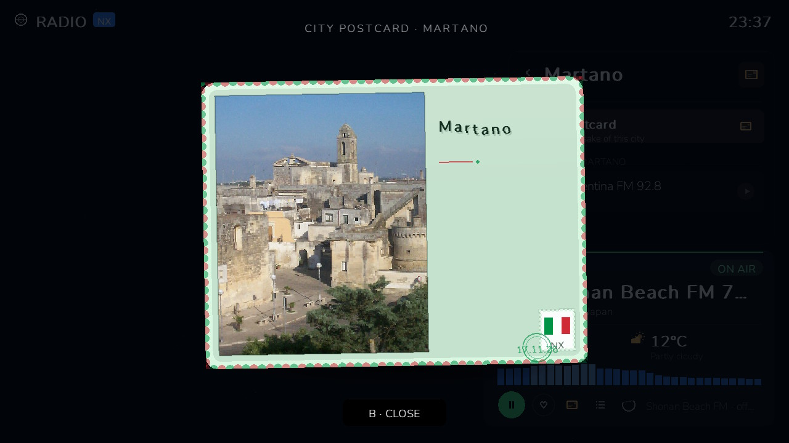

# RadioNX

### Discover the world through radio.

RadioNX is a free internet radio app for Nintendo Switch. It lets you tune in to radio stations from all over the world.

Spin an interactive 3D globe, pick a city, and listen to local radio. Every station is a quick trip somewhere new.

---

## Screenshots

### Main Menu

### Your Passport
Your personal RadioNX passport. Track the cities and countries you listen to, and collect stamps as you explore.

### Explore the World
Spin the 3D globe to look around the world and find local stations.

### Radio Selection
Pick a city, browse its stations, and start listening.

