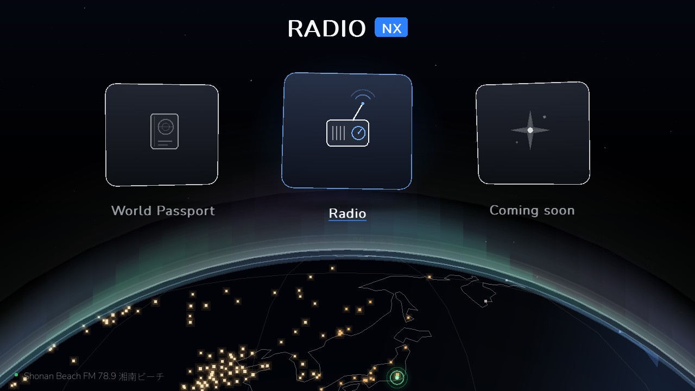
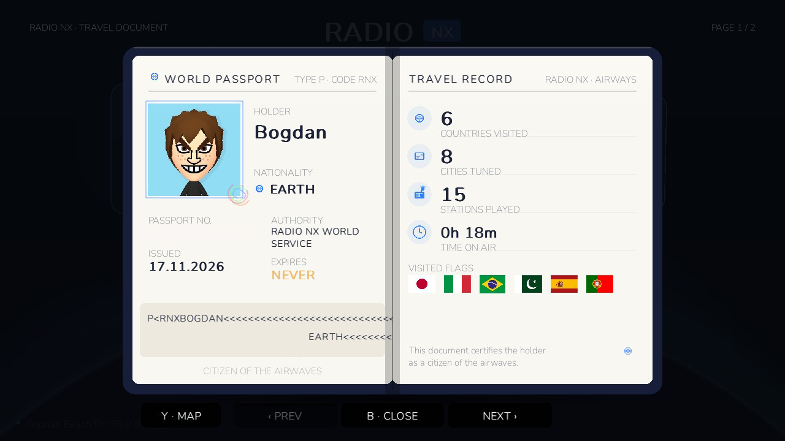
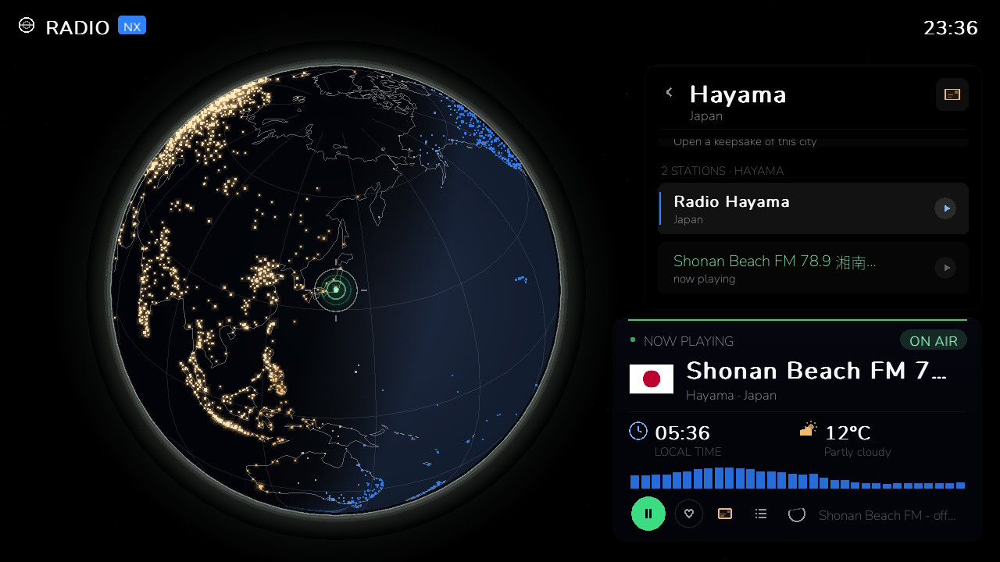
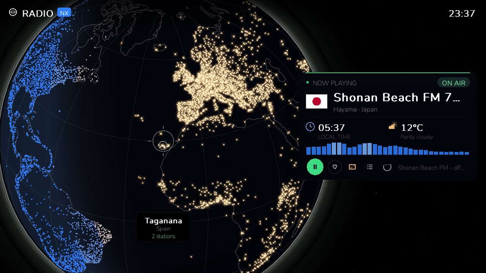
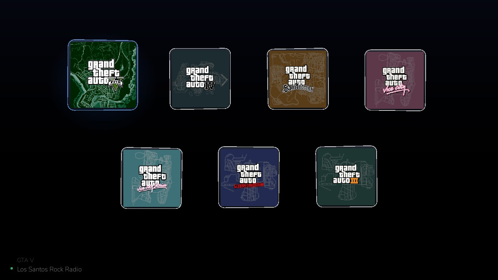

# RadioNX

### Discover the world through radio.

**RadioNX** is a free internet radio homebrew application for Nintendo Switch, combining worldwide radio, GTA radio stations, interactive exploration and a travel-inspired experience.

Explore an interactive 3D globe, discover radio stations from cities around the world, listen to broadcasts from Grand Theft Auto games and collect memories of your listening journey.

Every station is a new destination.

---

## Features

- **Interactive 3D Globe** — Explore the world, rotate the globe and discover radio stations by location.
- **Worldwide Radio** — Listen to radio stations from cities and countries around the globe.
- **GTA Radio** — Listen to radio stations from Grand Theft Auto games using streams from GTARadio.net.
- **Station Search** — Find radio stations and cities using the built-in search.
- **Random Discovery** — Let RadioNX take you somewhere unexpected with a random station.
- **World Passport** — Your personal listening passport with travel records, statistics and collectible country stamps.
- **City Postcards** — Discover visual postcards from the places you explore.
- **Favorites** — Save stations you enjoy and return to them anytime.
- **Presets** — Keep up to six stations for quick access.
- **Listening History** — Revisit your recently played stations.
- **Local Time & Weather** — See local time and weather information for the currently selected station location.
- **Audio Experience** — Enjoy live playback visualization, track information and customizable sound settings.
- **Night Mode** — Automatic night-time interface mode and a distraction-free Clean Mode.

---

## Screenshots

### Main Menu

Your starting point. Choose between your World Passport and the radio experience.

### World Passport

A personal passport that documents your journey through the world of radio.

Track your listening activity, discover new countries and cities, and collect unique entry stamps as you explore.

### Explore the Globe

An interactive 3D globe with radio destinations from around the world. Rotate it, explore different regions and discover local stations.

### Radio Stations

Choose a city, browse its available radio stations and tune in to local broadcasts.

### GTA Radio

Explore and listen to radio stations from the Grand Theft Auto series.

### City Postcards

Discover places around the world through visual city postcards.

---

## Additional Controls

- Hold **− and +** together to toggle Clean Mode.

---

## Development

RadioNX is an independent homebrew project currently in development.

New features, improvements and visual refinements are continuously being worked on.

Suggestions, feedback and bug reports are welcome through [GitHub Issues](https://github.com/Muveeer/RadioNX/issues).

---

## Credits & Third-Party Sources

- **[GTARadio.net](https://gtaradio.net)** — Source used for GTA Radio streams in RadioNX.

RadioNX is an independent project and is not affiliated with or endorsed by GTARadio.net, Rockstar Games or Take-Two Interactive.

Grand Theft Auto and related trademarks belong to their respective owners. Music and other third-party content remain the property of their respective rights holders.

---

## License

See [LICENSE](LICENSE) for the license covering this project.

Third-party libraries, fonts and other assets remain subject to their respective licenses.

---

**Created by Muveeer**

[GitHub Repository](https://github.com/Muveeer/RadioNX) · [Releases](https://github.com/Muveeer/RadioNX/releases) · [Issues](https://github.com/Muveeer/RadioNX/issues)
